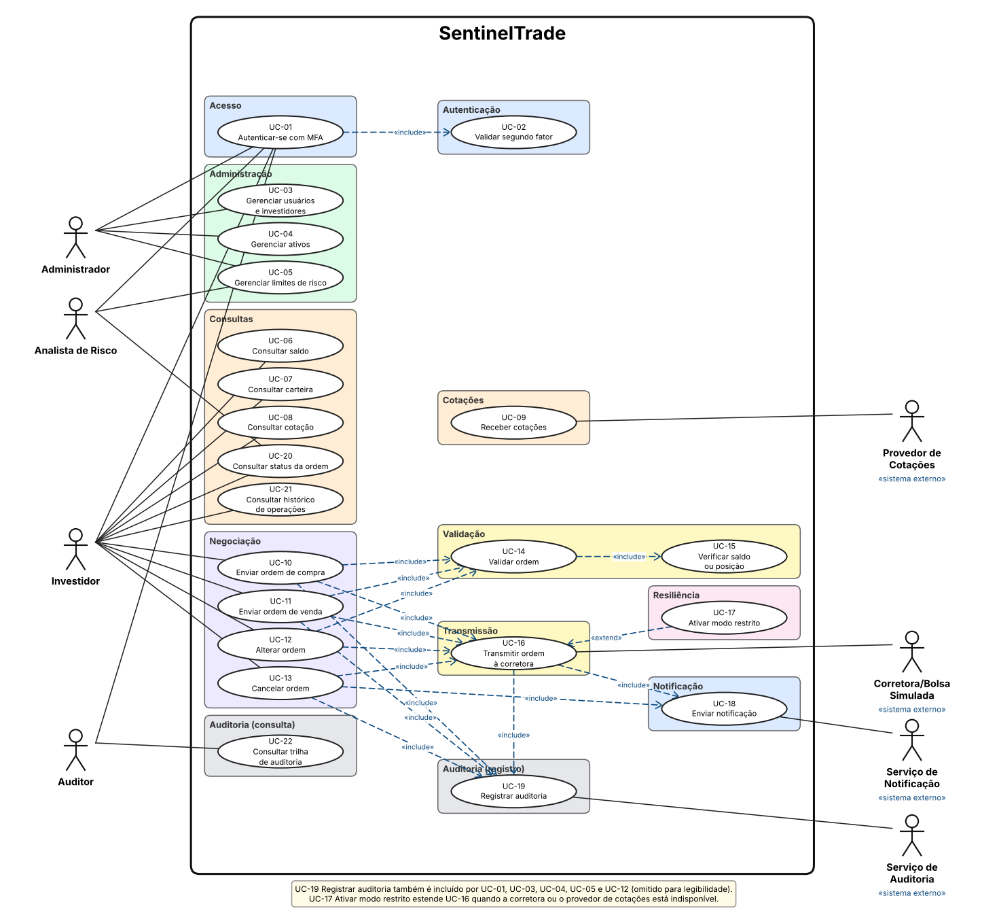

# SentinelTrade - Diagrama de Casos de Uso

O Modelo de Casos de Uso (MCU) representa um refinamento dos requisitos funcionais do sistema em desenvolvimento, sendo o diagrama de casos de uso a ferramenta da UML a ser utilizada. A construção desse modelo envolve a definição de diversos componentes: casos de uso, atores e relacionamentos entre eles.

As descrições textuais dos casos de uso críticos estão em [descricoes-casos-criticos.md](descricoes-casos-criticos.md).

## Identificação dos Atores

Na terminologia da UML, qualquer elemento externo ao sistema que interage com o mesmo é, por definição, denominado ator.

| Ator | Tipo | Descrição |
|----|----|-----------|
| **Investidor** | Ator principal | Consulta saldo, carteira, cotações, status e histórico; envia, altera e cancela ordens. |
| **Administrador** | Ator interno | Gerencia usuários, investidores, ativos e parâmetros operacionais. |
| **Analista de Risco** | Ator interno | Consulta e ajusta limites de risco e acompanha o status de ordens rejeitadas ou bloqueadas. |
| **Auditor** | Ator interno | Consulta a trilha de auditoria, sem poder de alteração sobre os registros. |
| **Corretora/Bolsa Simulada** | Sistema externo | Recebe as ordens válidas e retorna execução, rejeição ou falha. |
| **Provedor de Cotações** | Sistema externo | Fornece as cotações (simuladas) dos ativos. |
| **Serviço de Notificação** | Sistema externo | Entrega ao investidor os avisos de execução, rejeição, cancelamento ou falha. |
| **Serviço de Auditoria** | Sistema externo | Mantém o registro imutável de ações, decisões e mudanças de estado. |

## Casos de Uso

Por definição, é a especificação de uma sequência completa de interações entre um sistema e um ou mais agentes externos a esse sistema.

Relacionamentos `<<include>>` indicam um comportamento obrigatório dentro de outro caso de uso; `<<extend>>` indica um comportamento condicional. Eles ligam apenas casos de uso entre si; a ligação com os atores é uma associação simples.

| ID | Caso | Categoria | Ator(es) | Relacionamento | Descrição |
|---|---|---|---|---|---|
| UC-01 | **Autenticar-se com MFA** | Acesso | Investidor, Administrador, Analista de Risco, Auditor | Inclui: UC-02, UC-19 | Acesso com e-mail e senha seguido do segundo fator. |
| UC-02 | **Validar segundo fator** | Acesso | — | Incluído por: UC-01 | Confere o código do segundo fator (TOTP simulado). |
| UC-03 | **Gerenciar usuários e investidores** | Administração | Administrador | Inclui: UC-19 | Cadastra, edita e inativa usuários, investidores e contas. |
| UC-04 | **Gerenciar ativos** | Administração | Administrador | Inclui: UC-19 | Cadastra, ativa e suspende ativos e ajusta parâmetros operacionais. |
| UC-05 | **Gerenciar limites de risco** | Administração | Analista de Risco, Administrador | Inclui: UC-19 | Consulta e ajusta os limites de risco de cada investidor. |
| UC-06 | **Consultar saldo** | Consulta | Investidor | — | Mostra saldo disponível e bloqueado. |
| UC-07 | **Consultar carteira** | Consulta | Investidor | — | Mostra ativos, quantidades, preço médio e valor estimado. |
| UC-08 | **Consultar cotação** | Consulta | Investidor | — | Mostra preço, horário e variação dos ativos, sinalizando cotação desatualizada. |
| UC-09 | **Receber cotações** | Cotações | Provedor de Cotações | — | Recebe, valida e armazena as cotações. |
| UC-10 | **Enviar ordem de compra** | Negociação | Investidor | Inclui: UC-14, UC-16, UC-19 | Cria uma ordem de compra. |
| UC-11 | **Enviar ordem de venda** | Negociação | Investidor | Inclui: UC-14, UC-16, UC-19 | Cria uma ordem de venda. |
| UC-12 | **Alterar ordem** | Negociação | Investidor | Inclui: UC-14, UC-16, UC-19 | Altera quantidade ou preço de ordem não executada (cancela o restante e cria nova ordem vinculada). |
| UC-13 | **Cancelar ordem** | Negociação | Investidor | Inclui: UC-16, UC-18, UC-19 | Cancela uma ordem ainda não totalmente executada. |
| UC-14 | **Validar ordem** | Validação | — | Incluído por: UC-10, UC-11, UC-12 · Inclui: UC-15 | Confere dados da ordem, mercado aberto, ativo negociável, faixa de preço e limite de risco. |
| UC-15 | **Verificar saldo ou posição** | Validação | — | Incluído por: UC-14 | Verifica saldo para compra ou quantidade disponível para venda e faz o bloqueio. |
| UC-16 | **Transmitir ordem à corretora** | Transmissão | Corretora/Bolsa Simulada | Incluído por: UC-10, UC-11, UC-12, UC-13 · Inclui: UC-18, UC-19 · Estendido por: UC-17 | Envia a ordem (ou o cancelamento) e processa o retorno de execução, rejeição ou falha. |
| UC-17 | **Ativar modo restrito** | Resiliência | — | Estende: UC-16 | Se a corretora ou o provedor de cotações estiver indisponível, bloqueia novas ordens e mantém consultas e cancelamentos. |
| UC-18 | **Enviar notificação** | Notificação | Serviço de Notificação | Incluído por: UC-13, UC-16 | Avisa o investidor sobre execução, rejeição, cancelamento ou falha. |
| UC-19 | **Registrar auditoria** | Auditoria | Serviço de Auditoria | Incluído por: UC-01, UC-03, UC-04, UC-05, UC-10, UC-11, UC-12, UC-13, UC-16 | Registra de forma imutável a ação, o ator, a data/hora e o resultado. |
| UC-20 | **Consultar status da ordem** | Consulta | Investidor, Analista de Risco | — | Mostra o estado atual e a linha do tempo de uma ordem. |
| UC-21 | **Consultar histórico de operações** | Consulta | Investidor | — | Lista as ordens e execuções, com filtros por período, ativo e status. |
| UC-22 | **Consultar trilha de auditoria** | Auditoria | Auditor | — | Consulta o histórico de auditoria, sem poder de alteração. |

> No desenho, as inclusões de UC-19 vindas de UC-01, UC-03, UC-04, UC-05 e UC-12 estão indicadas em nota, para manter o diagrama legível; a tabela acima lista todas.
